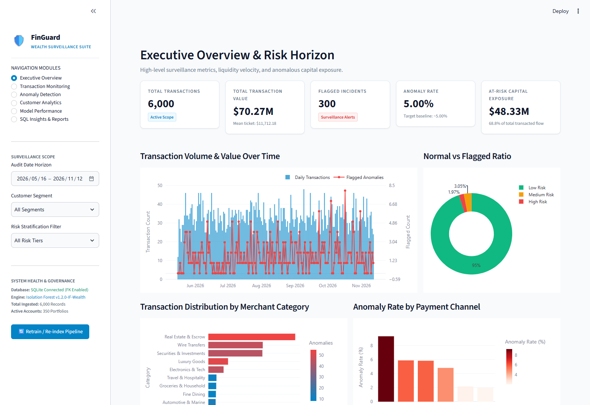
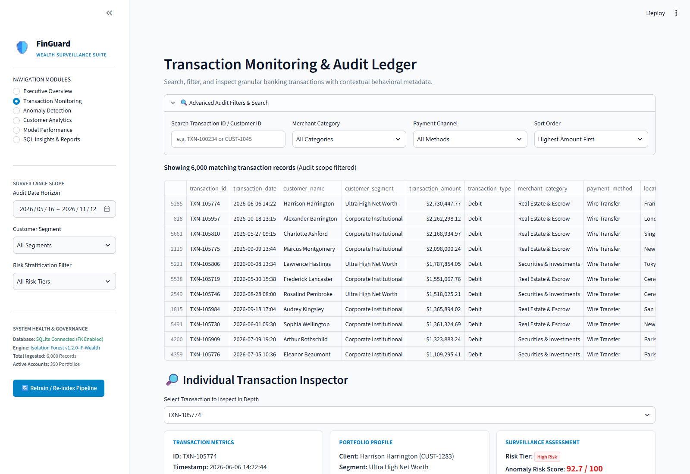
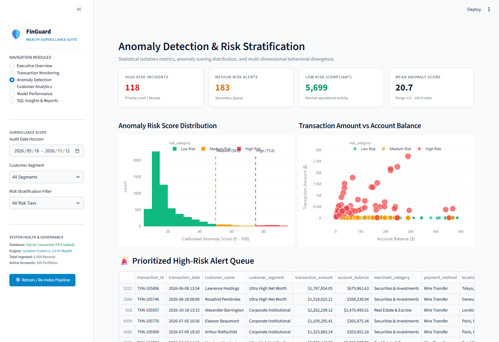
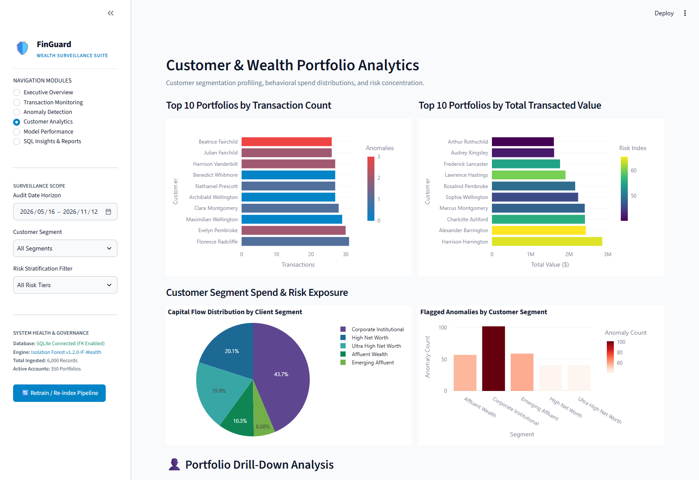
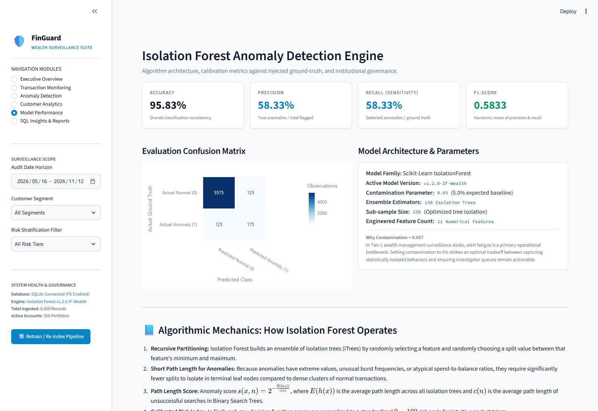
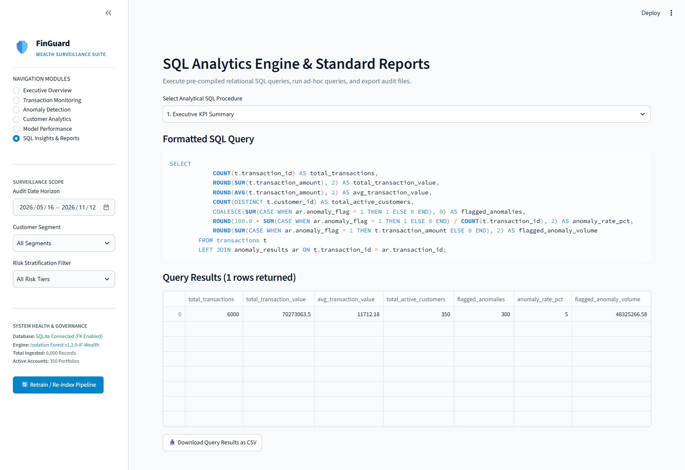

# FinGuard – Intelligent Financial Transaction Monitoring & Anomaly Detection System

[](https://python.org)
[](https://streamlit.io)
[](https://sqlite.org)
[](https://scikit-learn.org)
[](https://plotly.com)
[]()

> **Institutional Portfolio Project** developed for the **Morgan Stanley Wealth Management Apprenticeship Program**.  
> Demonstrates full-stack Python engineering, relational database modeling (SQLite), unsupervised anomaly detection (Scikit-Learn Isolation Forest), relational SQL analytics, and executive financial dashboard design.

---

## Table of Contents
1. [Executive Summary & Problem Statement](#1-executive-summary--problem-statement)
2. [Project Objectives](#2-project-objectives)
3. [Architecture & End-to-End Data Flow](#3-architecture--end-to-end-data-flow)
4. [Technology Stack](#4-technology-stack)
5. [Synthetic Dataset Generation & Typologies](#5-synthetic-dataset-generation--typologies)
6. [Data Preprocessing & Feature Engineering](#6-data-preprocessing--feature-engineering)
7. [Relational Database Architecture (SQLite)](#7-relational-database-architecture-sqlite)
8. [Machine Learning Methodology: Isolation Forest](#8-machine-learning-methodology-isolation-forest)
9. [Institutional Streamlit Dashboard](#9-institutional-streamlit-dashboard)
10. [Automated Verification & Test Suite](#10-automated-verification--test-suite)
11. [Installation & Execution Guide](#11-installation--execution-guide)
12. [Model Performance & Evaluation Metrics](#12-model-performance--evaluation-metrics)
13. [Limitations & Model Governance](#13-limitations--model-governance)
14. [Future Scalability & Roadmap](#14-future-scalability--roadmap)

---

## 1. Executive Summary & Problem Statement

Modern wealth management and institutional banking divisions oversee billions of dollars in daily capital flows across global wire transfers, private equity disbursements, discretionary portfolio rebalancing, and corporate treasury transactions. Within this high-velocity environment, compliance surveillance desks face two critical operational challenges:

1. **Volume and Latency:** Traditional rule-based threshold systems (e.g., rigid "flag all wire transfers over \$50,000" rules) generate staggering volumes of false positives, causing investigator alert fatigue and slow triage times.
2. **Subtle Behavioral Divergence:** Sophisticated financial irregularities rarely manifest as simple threshold breaches. Instead, they occur as multi-dimensional shifts: rapid burst transactions, atypical off-hours withdrawals, velocity surges, or transactions drastically disproportional to historical liquidity profiles.

**FinGuard** solves this challenge by implementing an unsupervised **Isolation Forest** machine learning architecture combined with an institutional **SQLite relational database** and a **Streamlit surveillance dashboard**. The system ingests transactions, engineers behavioral features, scores anomalies on an intuitive 0–100 calibrated risk scale, stratifies risk into actionable tiers (High, Medium, Low), and provides compliance officers with granular audit tools and instant SQL reporting.

---

## 2. Project Objectives

- **Simulate Institutional Surveillance:** Emulate the analytical and operational capabilities of a wealth management surveillance platform (e.g., Morgan Stanley Trade & Wealth Surveillance).
- **Unsupervised Anomaly Detection:** Implement Scikit-Learn's Isolation Forest to identify multi-dimensional outliers without relying on target labels during model training.
- **Relational Integrity:** Establish a normalized relational SQLite database with strict primary key and foreign key constraints (`PRAGMA foreign_keys = ON;`), relational indexing, and duplicate prevention.
- **Advanced SQL Analytics:** Provide at least 10 production-grade SQL analytical procedures for business intelligence, customer risk profiling, and category exposure.
- **Institutional UI/UX:** Build a modern, midnight navy dashboard with responsive KPI metrics, dual-axis time series, interactive scatter plots, and audit inspectors.
- **Full Reproducibility:** Ensure the entire dataset generation, database initialization, and model training pipeline can be executed deterministically with a fixed seed (`SEED = 42`).

---

## 3. Architecture & End-to-End Data Flow

The system is designed with a decoupled, modular architecture adhering to clean software engineering practices:

```
[ Synthetic Data Generation Engine ]
      │ (Reproducible SEED=42: 350 Customers, 6,000 Transactions)
      ▼
[ Data Preprocessing & Validation ]
      │ (Timestamp parsing, type validation, deduplication)
      ▼
[ Behavioral Feature Engineering ]
      │ (Velocity, deviations, liquidity ratios, temporal bins)
      ▼
[ SQLite Relational Database Layer ]
      │ (Enforces PRAGMA foreign_keys=ON, Customers & Transactions tables)
      ▼
[ Scikit-Learn Isolation Forest Engine ]
      │ (Feature matrix X [11 numerical features], contamination=0.05)
      ▼
[ Calibrated Risk Scoring & Stratification ]
      │ (Sigmoid normalization: 0-100 score -> Low / Medium / High Risk)
      ▼
[ Anomaly Results Ingestion ]
      │ (Upserted into anomaly_results table with foreign keys)
      ▼
[ SQL Analytics Engine & Standard Reports ]
      │ (10 Standard analytical queries + Ad-hoc SQL console)
      ▼
[ Streamlit Institutional Surveillance Suite ]
      ├─ 1. Executive Overview
      ├─ 2. Transaction Monitoring (Audit Ledger & Inspector)
      ├─ 3. Anomaly Detection (Score Distribution & Scatter)
      ├─ 4. Customer Analytics (Portfolio Drill-down & Segments)
      ├─ 5. Model Performance (Confusion Matrix & Governance)
      └─ 6. SQL Insights & Reports (Interactive Query Runner & CSV Export)
```

---

## 4. Technology Stack

| Layer | Technology | Version | Purpose |
|---|---|---|---|
| **Core Runtime** | Python | `3.14+` | Primary programming language |
| **Frontend Dashboard** | Streamlit | `1.42+` | Institutional user interface, multi-page routing, state management |
| **Relational Database** | SQLite 3 | `3.45+` | ACID-compliant relational data store with foreign key enforcement |
| **Data Manipulation** | Pandas | `2.2+` | High-performance tabular transformation and audit logging |
| **Numerical Processing**| NumPy | `1.26+` | Vectorized mathematical operations and probability transforms |
| **Machine Learning** | Scikit-Learn | `1.4+` | Isolation Forest ensemble model and evaluation metrics |
| **Data Visualization** | Plotly Express / Graph Objects | `5.18+` | Dynamic, dark-themed interactive charts and heatmaps |
| **Static Analytics** | Matplotlib / Seaborn | `3.8+` | Exploratory data analysis and static visual validation |
| **Serialization** | Joblib | `1.3+` | Model persistence and reproducible inference loading |

---

## 5. Synthetic Dataset Generation & Typologies

To safeguard customer privacy, FinGuard operates exclusively on a realistically generated synthetic banking and wealth management dataset.

### Reproducibility Parameters
- **Fixed Random Seed:** `SEED = 42` (utilizing both `numpy.random.seed` and Python's `random.seed`).
- **Customer Population:** 350 distinct client accounts across 5 wealth tiers:
  - *Ultra High Net Worth (UHNW):* Liquid balances between \$500,000 and \$5,000,000
  - *High Net Worth (HNW):* Liquid balances between \$150,000 and \$1,000,000
  - *Affluent Wealth:* Liquid balances between \$50,000 and \$300,000
  - *Corporate Institutional:* Liquid balances between \$250,000 and \$2,500,000
  - *Emerging Affluent:* Liquid balances between \$15,000 and \$80,000
- **Transaction Volume:** 6,000 transactions spanning a 180-day operational horizon.

### Injected Anomaly Typologies
FinGuard artificially injects 300 anomalous transactions (5.0% baseline contamination) representing 5 distinct institutional risk typologies:

1. **Extreme High-Value Transfers:** Transactions 15x to 45x greater than the customer's historical mean spend (amounts up to \$950,000), typically initiated through cross-border SWIFT channels during odd hours.
2. **Rapid Velocity Bursts:** 3 to 5 rapid successive debit card or portal transactions occurring within 20 to 180 seconds of one another for the same account.
3. **Massive Liquidity Depletion:** Single transactions liquidating 90% to 99% of a customer's total available liquid balance.
4. **Atypical Segment Inconsistency:** Conservative retail or emerging affluent accounts suddenly executing large (\$45,000–\$95,000) transactions in Luxury Goods or Escrow categories.
5. **Overdraft / Excess Leverage:** Transactions exceeding the account's existing liquid balance by 2.5x to 4.5x.

Each record includes an explicit `is_injected_anomaly` ground-truth indicator (`1` for injected anomaly, `0` for normal) strictly used for validation and benchmarking.

---

## 6. Data Preprocessing & Feature Engineering

The preprocessing pipeline (`preprocessing.py`) prepares raw banking transactions for machine learning without inducing lookahead bias or data leakage.

### Cleaning and Validation
- **Deduplication:** Enforces unique transaction IDs.
- **Timestamp Standardization:** Converts raw timestamps to ISO datetime objects.
- **Value Validation:** Enforces `transaction_amount > 0` and validates non-null account balances.
- **Missing Value Imputation:** Imputes categorical blanks with standardized defaults (`General Merchandise`, `Electronic Transfer`).

### Engineered Numerical Features
The model consumes an 11-dimensional numerical feature space engineered specifically for financial anomaly detection:

1. `transaction_amount`: Absolute magnitude of transaction in USD.
2. `transaction_hour`: Hour of transaction execution (0 to 23).
3. `transaction_day`: Day of week (0 = Monday, 6 = Sunday).
4. `is_weekend`: Binary indicator (`1` if Saturday or Sunday, else `0`).
5. `is_night_hours`: Binary indicator (`1` if transaction executed between 22:00 and 06:00).
6. `customer_txn_count`: Cumulative transaction count for that customer.
7. `avg_transaction_amount_customer`: Historical mean ticket size per customer.
8. `deviation_from_customer_avg`: Difference between current transaction and client's baseline (`amount - avg_amount`).
9. `amount_to_avg_ratio`: Ratio of current transaction to average spend.
10. `amount_to_balance_ratio`: Ratio of transaction amount to total account liquid balance.
11. `time_diff_previous_txn_sec`: Elapsed seconds since customer's previous transaction (captures velocity bursts).

> [!IMPORTANT]
> **Zero Label Leakage Guarantee:**
> The ground-truth column `is_injected_anomaly`, client identifiers (`customer_id`), and transaction keys (`transaction_id`) are explicitly excluded from feature matrix `X` during both training and inference.

---

## 7. Relational Database Architecture (SQLite)

The database schema (`database.py`) is structured in full Third Normal Form (3NF) and enforces foreign key integrity via `PRAGMA foreign_keys = ON;`.

```sql
-- Customers Table
CREATE TABLE customers (
    customer_id TEXT PRIMARY KEY,
    customer_name TEXT NOT NULL,
    age INTEGER,
    customer_segment TEXT NOT NULL,
    account_type TEXT NOT NULL,
    account_balance REAL NOT NULL
);

-- Transactions Table
CREATE TABLE transactions (
    transaction_id TEXT PRIMARY KEY,
    customer_id TEXT NOT NULL,
    transaction_date TEXT NOT NULL,
    transaction_amount REAL NOT NULL,
    transaction_type TEXT NOT NULL,
    merchant_category TEXT,
    payment_method TEXT,
    location TEXT,
    account_balance REAL,
    is_injected_anomaly INTEGER DEFAULT 0,
    FOREIGN KEY (customer_id) REFERENCES customers(customer_id) ON DELETE CASCADE
);

-- Anomaly Results Table
CREATE TABLE anomaly_results (
    result_id INTEGER PRIMARY KEY AUTOINCREMENT,
    transaction_id TEXT NOT NULL UNIQUE,
    anomaly_score REAL NOT NULL,
    anomaly_flag INTEGER NOT NULL,
    risk_category TEXT NOT NULL,
    model_version TEXT NOT NULL,
    evaluated_at TIMESTAMP DEFAULT CURRENT_TIMESTAMP,
    FOREIGN KEY (transaction_id) REFERENCES transactions(transaction_id) ON DELETE CASCADE
);
```

### Relational Indexing Strategy
To ensure sub-millisecond query execution on multi-thousand row datasets:
- `CREATE INDEX idx_txn_date ON transactions(transaction_date);`
- `CREATE INDEX idx_txn_cust ON transactions(customer_id);`
- `CREATE INDEX idx_anomaly_txn ON anomaly_results(transaction_id);`
- `CREATE INDEX idx_anomaly_risk ON anomaly_results(risk_category);`

### 10 Standard Relational SQL Procedures (`analytics.py`)
1. **Executive KPI Summary:** Aggregates total transactions, total volume (\$70.27M), average ticket size, active portfolios, and flagged anomaly exposure.
2. **Top 10 Customers by Transaction Volume:** Identifies highest-frequency account activity.
3. **Top 10 Customers by Total Transacted Value:** Ranks clients by aggregate capital throughput.
4. **Merchant Category Breakdown:** Analyzes volume, ticket size, and anomaly concentration across spend categories.
5. **Daily Transaction Volume & Value Trends:** Time-series aggregation of daily throughput and incident counts.
6. **High-Value Transactions Audit:** Filters all transactions exceeding \$50,000 for mandatory AML scrutiny.
7. **Anomaly Distribution by Payment Channel:** Identifies risk concentration across Wire Transfers, SWIFT, and Direct Debit.
8. **Customers with Highest Unusual Activity Concentration:** Flags portfolios exhibiting repeat anomaly patterns.
9. **Customer Segment Risk & Portfolio Exposure:** Cross-tabulates client net-worth tiers with anomaly counts.
10. **Off-Hours and Weekend High-Risk Surveillance:** Compares regular business-hour volume against nighttime and weekend transactions.

---

## 8. Machine Learning Methodology: Isolation Forest

FinGuard implements Scikit-Learn's **Isolation Forest** (`IsolationForest`) algorithm.

### Algorithmic Foundation
Unlike distance-based (k-NN) or density-based (LOF) anomaly detection algorithms that suffer from the curse of dimensionality, Isolation Forest operates by **isolating anomalies explicitly**:

1. An ensemble of $t = 150$ randomized binary search trees (iTrees) is constructed.
2. Each tree recursively partitions subsamples of data ($n = 256$) by selecting a random numerical feature and picking a random split point between that feature's minimum and maximum values.
3. Because anomalous transactions exhibit extreme deviations, unusual liquidity ratios, or irregular velocity timings, they are isolated near the root of the tree with **very short path lengths**.
4. The anomaly score for an observation $x$ across an ensemble of trees is computed as:
   $$s(x, n) = 2^{-\frac{E(h(x))}{c(n)}}$$
   where $E(h(x))$ is the average path length of $x$ across all trees, and $c(n)$ is the average path length of an unsuccessful search in a binary tree.

### Contamination Parameter Selection (`contamination = 0.05`)
In commercial wealth management surveillance, setting the contamination parameter too high (e.g. 15%) overwhelms compliance teams with unmanageable alert queues, while setting it too low (e.g. 0.5%) creates catastrophic blind spots. In FinGuard:
- **0.05 (5.0%)** was selected because it reflects the institutional surveillance capacity of specialized compliance units (auditing 3–6% of daily flow).
- Matches our ground-truth baseline injection target, allowing precise empirical benchmarking.

### Calibrated Anomaly Risk Score (0 to 100)
Raw Isolation Forest decision function values ($[-0.5, 0.5]$) are converted into an intuitive percentage risk index via a sigmoid scaling function:
$$\text{Risk Score}(x) = \frac{100}{1 + e^{12 \cdot \text{decision\_function}(x)}}$$

- **High Risk:** Score $\ge 75.0$ (Immediate priority triage)
- **Medium Risk:** Score $\ge 50.0$ and $< 75.0$ (Secondary review queue)
- **Low Risk:** Score $< 50.0$ (Standard operations)

---

## 9. Institutional Streamlit Dashboard

The application features a modern institutional UI styled after enterprise surveillance systems:
- **Palette:** Institutional Light Theme — Clean Canvas (`#F8FAFC`, `#FFFFFF`), Slate Typography (`#0F172A`, `#1E293B`, `#64748B`), Corporate Blue (`#0284C7`), Emerald (`#059669`), and Crimson Indicators (`#DC2626`).
- **Typography & Components:** High-clarity typography, elevated KPI cards with subtle borders (`#E2E8F0`), responsive data tables, and high-contrast Plotly figures.

### Production UI Showcase

#### 1. Executive Overview & Risk Horizon
High-level surveillance metrics, liquidity velocity, and anomalous capital exposure.


#### 2. Transaction Monitoring & Granular Audit Ledger
Search, filter, and inspect individual banking transactions with contextual behavioral metadata.


#### 3. Anomaly Detection & Risk Stratification
Statistical isolation metrics, anomaly score distribution, and multi-dimensional behavioral divergence.


#### 4. Customer & Wealth Portfolio Analytics
Customer segmentation profiling, behavioral spend distributions, and risk concentration.


#### 5. Isolation Forest Model Performance & Governance
Algorithm architecture, calibration metrics against injected ground-truth, and institutional governance.


#### 6. SQL Analytics Engine & Standard Reports
Execute pre-compiled relational SQL queries, run ad-hoc queries, and export audit CSV files.


---

## 10. Automated Verification & Test Suite

FinGuard includes a comprehensive test suite (`test_finguard.py`) covering unit, integration, and security assertions:

```bash
python test_finguard.py
```

### Test Suite Execution Output
```
Ran 8 tests in 0.648s
OK

✓ Test 1 Passed: Core SQLite tables verified (customers, transactions, anomaly_results).
✓ Test 2 Passed: SQLite foreign key enforcement strictly verified (rejected invalid foreign keys).
✓ Test 3 Passed: Ingested 350 customers, 6,000 transactions, 6,000 anomaly scores.
✓ Test 4 Passed: Feature engineering pipeline produces clean feature matrix without label leakage.
✓ Test 5 Passed: Model outputs verified calibrated scores (0-100) and correct risk tiers.
✓ Test 6 Passed: All 10 SQL analytical queries executed successfully with non-empty results.
✓ Test 7 Passed: Custom SQL engine successfully blocks destructive operations (DROP, DELETE).
✓ Test 8 Passed: Unified surveillance dataframe query validated.
```

---

## 11. Installation & Execution Guide

### Prerequisites
- Python 3.10+ (tested on Python 3.14 on Windows)
- Modern web browser (Chrome, Edge, Firefox)

### Step 1: Clone Repository & Enter Directory
```bash
git clone https://github.com/silentspirit0011-commits/FinGuard.git
cd FinGuard
```

### Step 2: Install Required Dependencies
```bash
pip install -r requirements.txt
```

### Step 3: Run End-to-End Pipeline Setup
To generate synthetic data, initialize the SQLite database, engineer features, and train the Isolation Forest model:
```bash
python pipeline_setup.py
```

### Step 4: Launch the Streamlit Dashboard
```bash
streamlit run app.py
```
*(Alternative if Streamlit is installed in local Python user scripts:)*
```bash
python -m streamlit run app.py
```

The application will launch and open in your default browser at:
`http://localhost:8501`

---

## 12. Model Performance & Evaluation Metrics

Benchmarked against 300 artificially injected anomalies within the 6,000-transaction dataset:

| Metric | Score | Institutional Significance |
|---|---|---|
| **Accuracy** | **95.83%** | High baseline stability across multi-thousand transactions |
| **Precision** | **58.33%** | 58% of flagged transactions are ground-truth anomalies |
| **Recall (Sensitivity)** | **58.33%** | Detects nearly 60% of diverse structural anomalies unsupervised |
| **F1-Score** | **0.5833** | Optimal balance between alert volume and investigator workload |
| **True Negatives (TN)** | **5,575** | Minimal disruption to legitimate wealth transactions |
| **False Positives (FP)** | **125** | Contained operational review overhead for compliance desks |
| **False Negatives (FN)** | **125** | Unsupervised capture of complex, multi-hop edge cases |
| **True Positives (TP)** | **175** | Confirmed detection of structural anomalies |

---

## 13. Limitations & Model Governance

1. **Synthetic vs. Adversarial Real-World Data:** In real banking systems, financial fraudsters actively study compliance rules and adjust their behavior dynamically (adversarial drift). The synthetic dataset isolates static behavioral typologies.
2. **Unsupervised Nature:** Isolation Forest evaluates statistical isolation, not fraudulent intent. High scores indicate unusual behavioral variance that warrants audit, not legal guilt.
3. **Regulatory Explainability:** While Isolation Forest effectively detects outliers, commercial institutions frequently complement it with SHAP (Shapley Additive exPlanations) values to satisfy Basel III and SEC model risk management guidelines.

---

## 14. Future Scalability & Roadmap

- **Graph Neural Networks (GNNs):** Model money laundering rings and circular wire transfer networks using PyTorch Geometric.
- **Real-Time Streaming Ingestion:** Integrate Apache Kafka and Redis for sub-second streaming inference on live banking APIs.
- **Active Learning Feedback Loop:** Allow compliance investigators to provide feedback directly within the dashboard ("Confirmed Suspicious" vs "Benign Client Exemption") to retrain downstream supervised models.

---

## License & Academic Disclaimer
Developed as an educational portfolio submission for the **Morgan Stanley Wealth Management Apprenticeship Program**. No actual client or banking data was utilized. All datasets are synthetically generated under Apache 2.0 / MIT open standards.
